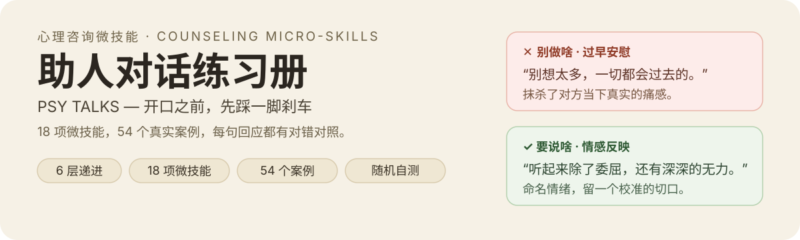
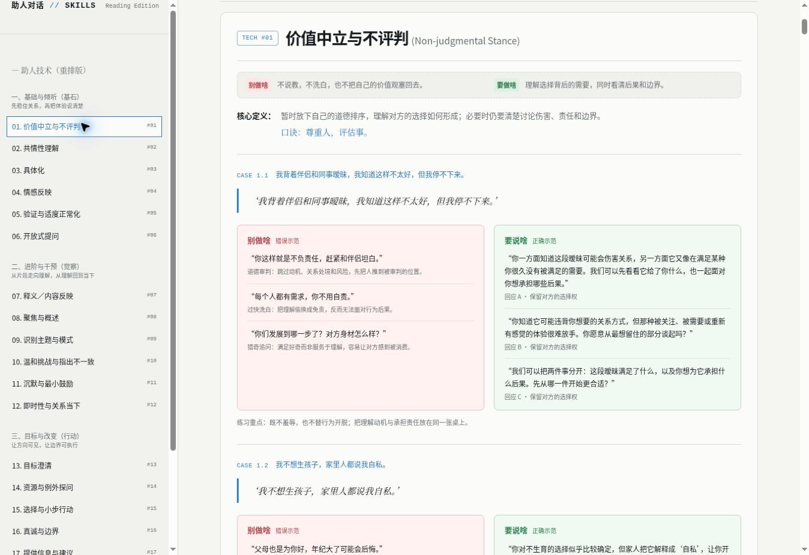

<p align="right"><a href="README.md">中文</a></p>

<p align="center">
  
</p>

<p align="center">
  <a href="https://psy-talks.xiaosang.cc/">▶ Live Demo · Practice Map</a>
  ·
  <a href="https://psy-talks.xiaosang.cc/v2/">📖 Reading Edition v2</a>
  ·
  <a href="https://github.com/holynova/psy-talks">GitHub Repository</a>
</p>

Psy Talks is a mobile-first practice map for counseling micro-skills: humanistic helping skills broken into 6 developmental layers, 18 techniques, and 54 real cases. Every technique pairs a high-fidelity 「别做啥」 ("Don't say this") with a 「要说啥」 ("Say this instead") — so you learn to pause before you speak.

## Screenshot

<p align="center">
  
</p>

## Contents

Six layers, from shallow to deep — a staircase of psychological safety:

| Layer | Theme | Focus |
|------|------|------|
| 01 | 先把关系站稳 Stabilize the relationship first | Attitude before technique, empathic understanding, entering the other's frame of reference |
| 02 | 把模糊说清楚 Make the vague clear | Restoring facts and experience, concretizing, separating facts from interpretations |
| 03 | 让情绪被看见 Let emotions be seen | Naming without labeling, reflecting feelings, focusing on body-mind experience |
| 04 | 让模式浮出来 Let patterns surface | From fragments to understanding, restating contradictions, pattern recognition, hypothesis testing |
| 05 | 把领悟落到行动 Turn insight into action | The client decides, micro-steps, activating resources |
| 06 | 守住边界与安全 Hold boundaries and safety | Professional bottom lines, ethical risk awareness, crisis intervention and referral |

Each case has four parts: **真实原声** ("The real voice", the speaker's own words), **典型错漏** ("Typical mistakes", 3 common wrong replies and why they cause secondary harm), **更优范式** ("Better models", 3 better replies with calibration openings), **督导精要** ("Supervisor's notes", the key point behind the situation).

## Features

- **Practice map** (`/`): a skill-matrix card grid — filter by layer, search by keyword, check off items to track completion.
- **Reading edition** (`/v2`): book-style layout with anchored skill navigation on the left and full red/green comparisons in the text.
- **Random self-test**: only the scenario, no model reply — say a line in your head first, then check yourself against the skill map.

## Run Locally

```bash
npm install
npm run dev           # Dev server
npm run build         # Production build
npm run build:pages   # Bundle into docs/ (GitHub Pages)
npm test              # Build + render verification tests
```

## Tech

- React 19 + TypeScript + Vite, with no runtime dependencies beyond React itself; all content is structured data in `app/content.ts` (layers / skills / cases).
- Grounded in classic humanistic helping skills (Hill / Rogers / Egan); skill mnemonics and cases are original compilations.

```
app/page.tsx            Practice map home (filter / search / completion checkmarks / random self-test)
app/v2/page.tsx         Reading edition
app/content.ts          All content data: 6 layers / 18 skills / 54 cases
app/globals.css         Warm paper style
tests/rendered-html.test.mjs   Render verification tests
```

## Disclaimer

This project's content is a teaching and self-training reference for psychology helping skills and conversation techniques. **It does not constitute, and cannot replace, professional psychological counseling, clinical psychotherapy, or psychiatric diagnosis.** In a psychological emergency, self-harm, or a severe depressive episode, seek care at a local hospital's psychiatry department immediately, or call a crisis hotline (mainland China: `400-161-9995` / `010-82951332`).
