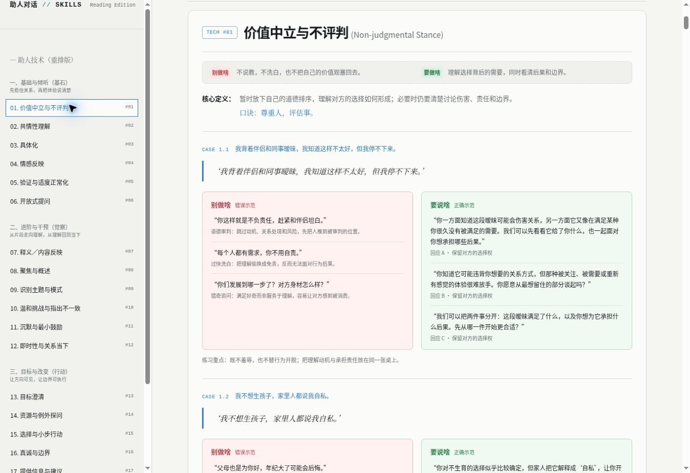

<p align="center">
  
</p>

<p align="center">
  <a href="https://psy-talks.xiaosang.cc/">▶ 在线体验 · 练习地图</a>
  ·
  <a href="https://psy-talks.xiaosang.cc/v2/">📖 参考阅读版 v2</a>
  ·
  <a href="https://github.com/holynova/psy-talks">GitHub 仓库</a>
</p>

助人对话练习册是心理咨询常见对话微技能的移动端练习地图：把人本主义助人技术拆成 6 个递进层级、18 项微技能、54 个真实案例，每项技能都有「别做啥 / 要说啥」的高保真对照——开口之前，先踩一脚刹车。

Psy Talks is a mobile-first practice map for counseling micro-skills: 6 developmental layers, 18 techniques, 54 real cases. Every technique pairs a "Don't say this" with a "Say this instead", so you learn to pause before you speak.

## 截图 / Screenshots

<p align="center">
  
</p>

## 内容结构 / Contents

六个层级由浅入深，是一条心理安全的阶梯：

| 层级 | 主题 | 要点 |
|------|------|------|
| 01 | 先把关系站稳 | 态度先于技巧，共情性理解，进入对方参照系 |
| 02 | 把模糊说清楚 | 事实与体验还原，具体化，区分事实与解释 |
| 03 | 让情绪被看见 | 命名而不盖章，情感反映，聚焦身心体验 |
| 04 | 让模式浮出来 | 从片段到理解，矛盾重述，模式识别，假设检验 |
| 05 | 把领悟落到行动 | 由来访者做主，微步行动，资源激活 |
| 06 | 守住边界与安全 | 专业底线，伦理风险识别，危机干预与转介 |

每个案例由四部分组成：**真实原声**（倾诉者原话）、**典型错漏**（3 个常见失误回应及为何造成二次伤害）、**更优范式**（3 个带校准切口的更优表达）、**督导精要**（情境背后的要点提炼）。

## 功能 / Features

- **练习地图**（`/`）：技能矩阵卡片，按层级筛选、按关键词搜索，逐项打勾记录完成进度。
- **参考阅读版**（`/v2`）：书籍式编排，左侧技能锚点导航，正文完整呈现红绿两列对错照。
- **随机自测**：只给场景、不给参考回应，先在心里说一句，再回技能地图自检。

## 本地运行 / Run Locally

```bash
npm install
npm run dev           # 开发服务器
npm run build         # 生产构建
npm run build:pages   # 打包到 docs/（GitHub Pages）
npm test              # 构建 + 渲染验证测试
```

## 技术 / Tech

- React 19 + TypeScript + Vite，零运行时依赖之外只用 React；内容全部结构化在 `app/content.ts`（层级 / 技能 / 案例）。
- 理论底色是经典人本主义助人技术（Hill / Rogers / Egan），技能口诀与案例均为原创整理。

```
app/page.tsx            练习地图主页（筛选 / 搜索 / 完成打勾 / 随机自测）
app/v2/page.tsx         参考阅读版
app/content.ts          全部内容数据：6 层级 / 18 技能 / 54 案例
app/globals.css         米白纸张风格
tests/rendered-html.test.mjs   渲染验证测试
```

## 免责声明 / Disclaimer

本项目内容属于心理学助人技术与对话沟通技巧的教学与自我训练参考，**不构成也不可替代专业心理咨询、临床心理治疗或精神科医学诊断**。如遇紧急心理危机、自伤自残或重度抑郁发作，请立即向当地医院精神心理科就诊，或拨打全国心理危机干预热线（中国大陆：`400-161-9995` / `010-82951332`）。

## English

**Psy Talks** is a mobile-first practice map for counseling micro-skills, grounded in humanistic helping skills (Hill / Rogers / Egan): 6 developmental layers, 18 techniques, 54 real cases.

- **Don't / Do, side by side**: each case shows a real situation, 3 common wrong replies (with why they hurt), 3 better replies with calibration openings ("Am I getting this right?"), and a supervisor's note.
- **Layers**: 01 stabilize the relationship → 02 clarify facts → 03 name emotions → 04 surface patterns → 05 move to action → 06 hold boundaries and safety.
- **Two views**: the practice map (`/`) with layer filters, search, completion checkmarks, and random self-tests; the reading edition (`/v2`) with anchored navigation and full red/green comparisons.
- **Run it**: `npm install && npm run dev`. Build with `npm run build`; `npm test` runs the render verification.
- **Tech**: React 19 + TypeScript + Vite; all content is structured data in `app/content.ts`.
- **Disclaimer**: teaching and self-training reference only — not a substitute for professional counseling, psychotherapy, or medical diagnosis.
